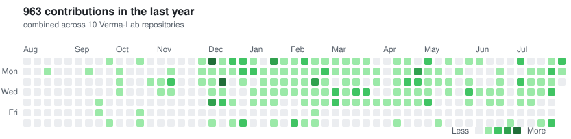
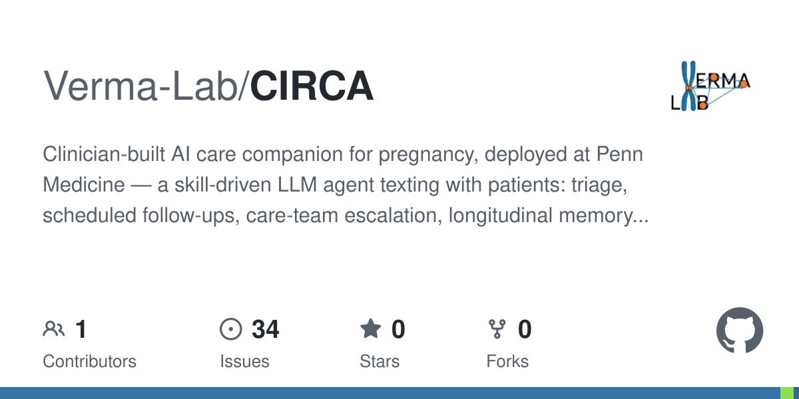
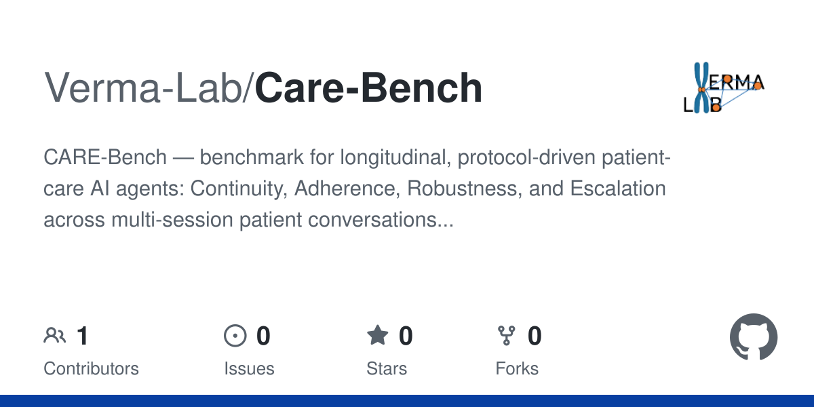

# Verma Lab

**Population Genomics &nbsp;·&nbsp; Biomedical Informatics &nbsp;·&nbsp; AI for Medicine**

Division of Translational Medicine & Human Genetics · Department of Biostatistics, Epidemiology and Informatics
**Perelman School of Medicine, University of Pennsylvania**

---

## About

We are a research group led by **[Anurag Verma, PhD](https://dbei.med.upenn.edu/staff/anurag-verma-phd/)** at the University of Pennsylvania. Our program sits at the intersection of **statistical genomics, biobank-scale informatics, and machine learning** — from characterizing the genetic architecture of complex disease across diverse ancestries, to building the software and AI systems that turn biobank and clinical data into deployed precision-medicine tools.

The lab leads clinical informatics and genomics efforts for the **Penn Medicine BioBank (PMBB)** and collaborates with national networks including the **VA Million Veteran Program** and federal research partners to scale biobank-based precision health.

## Research Areas

| | Area | What we do |
|---|---|---|
| 🧬 | **Statistical & Population Genomics** | GWAS/PheWAS of complex traits across ancestries, pleiotropy, rare-variant association from whole-exome/-genome sequencing, sex-specific genetic effects |
| 🏥 | **Biobank-Scale Informatics** | Cross-biobank analysis pipelines (Nextflow/SAIGE) spanning PMBB, MVP, UK Biobank, FinnGen, Biobank Japan and more; imaging-derived phenotypes from clinical CT/MRI |
| 🤖 | **AI & LLM Agents for Clinical Care** | Conversational care agents deployed in patient-facing workflows, LLMs for clinical prediction and rare-disease detection, and benchmarks for evaluating medical AI agents |
| 📈 | **Deep Learning on Physiological Signals** | Foundation-model and interpretable deep-learning approaches for ECG classification, evaluated at biobank scale |

## Featured Projects

| Project | Description |
|---|---|
| **[PLATLAS](https://github.com/Verma-Lab/platlas)** | *PLeiotropic ATLAS* — interactive web browser for multi-ancestry GWAS/PheWAS results across six biobanks (MVP, UKB, FinnGen, BBJ, ToMMo, KoGES; ~1,700 traits): Manhattan/Hudson plots, cross-population comparison, summary-statistic downloads |
| **[CIRCA](https://github.com/Verma-Lab/CIRCA)** | Clinician-built **AI care companion for pregnancy**, deployed at Penn Medicine — a skill-driven LLM agent that texts with patients over SMS: onboarding and consent, symptom triage against clinical protocols, scheduled follow-up check-ins, care-team notifications and escalation, with longitudinal per-patient memory across sessions |
| **[CARE-Bench](https://github.com/Verma-Lab/Care-Bench)** | Benchmark for **longitudinal, protocol-driven patient-care AI agents** — scoring continuity, adherence, robustness, and escalation across multi-session patient conversations; born from CIRCA's real-world deployment |
| **[HCC Rare-Variant Analysis](https://github.com/Verma-Lab/hcc-rare-variant-analysis)** | Genetic associations with hepatocellular carcinoma using whole-exome and whole-genome sequencing across multiple biobanks |
| **[Hepatic Fat GWAS](https://github.com/Verma-Lab/hepatic-fat-gwas)** | Sex-specific genetic effects on hepatic fat and liver health using CT-derived imaging phenotypes |
| **[PMBB IDP GWAS](https://github.com/Verma-Lab/pmbb_idp_gwas)** | Nextflow pipelines (SAIGE family toolkit) for imaging-derived-phenotype GWAS at biobank scale |

## Lab Activity

## Repositories

## Stack

## Working With Us

We collaborate broadly across genomics, informatics, and clinical AI. For questions about our work, collaborations, or joining the lab, reach out through the **[lab page](https://dbei.med.upenn.edu/staff/anurag-verma-phd/)**.

Verma Lab · Perelman School of Medicine · University of Pennsylvania

